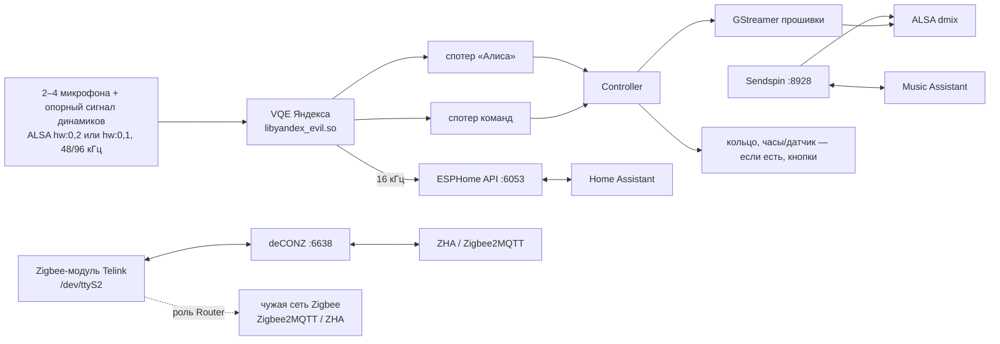

# pulsar

Яндекс Станция Миди (кодовое имя `cucumber`), Яндекс Станция Лайт 2 (`plum`), Яндекс Станция
Мини 2 (`station-mini2`), Яндекс Станция Мини 3 (`bergamot`) и Мини первого поколения
(`yandexmini`) как локальный голосовой спутник и
умная колонка для [Home Assistant](https://www.home-assistant.io/) — без облака Яндекса.

> Поддержка Мини 2 экспериментальная, см. [Мини 2](#мини-2).

> Поддержка Мини 3 экспериментальная, см. [Мини 3](docs/mini3.md).

Вместо штатного стека Яндекса (`maind`) на колонке работает небольшой нативный демон. Он говорит с
Home Assistant по протоколу ESPHome Native API и выглядит в HA как обычное ESPHome-устройство.
Для [Music Assistant](https://music-assistant.io/) он дополнительно является нативным
[Sendspin](https://www.sendspin-audio.com/)-плеером.

Железо колонки используется полностью и штатными средствами прошивки:

- **«Алиса» / «Яндекс»** — родная модель активационной фразы Яндекса и родное
  шумоподавление/эхоподавление (VQE) по микрофонам колонки (Миди — 4, Лайт 2 — 2, Мини 2 — 4,
  Мини 3 — 3, Мини — 4) с вычитанием звука собственных динамиков.
- **Локальные голосовые команды** — «стоп», «громче», «тише», «продолжи» и т. д. выполняются на
  самой колонке, без HA и без «Алиса» (родная модель команд Яндекса).
- **Отвечает ближайшая колонка** — если «Алису» услышали несколько колонок с pulsar, отвечает та,
  что услышала громче.
- **Динамики** — воспроизведение HTTP-потоков через GStreamer прошивки, громкость через ALSA.
- **Кольцо светодиодов (Миди — 24 и логотип, Лайт 2 — 3, Мини 2, Мини 3 и Мини — 6), часы,
  кнопки, переключатель микрофона, датчик освещённости.** У Мини нет часов, датчика освещённости,
  аппаратного переключателя MUTE, кнопки TALK и кнопок громкости: кнопка отключения микрофонов
  переключает программный мут (состояние сохраняется на диск сразу), а громкость регулируется
  программно (через HA, голосом или Sendspin).
- **Zigbee (Миди, экспериментально)** — встроенный Zigbee-модуль колонки на собственной прошивке
  pulsar работает полноценным координатором для Zigbee2MQTT и ZHA (как USB-стик ConBee) или
  роутером (ретранслятором) в существующей сети (см. [Zigbee](#zigbee-миди)).

Ни одна проприетарная библиотека Яндекса в репозитории не распространяется: демон загружает их с
самой колонки во время работы.

> Проект не связан с Яндексом. Всё, что вы делаете с устройством, — на ваш страх и риск.

## Что появляется в Home Assistant

Если не указано иное, сущность есть на всех моделях. Часы (все сущности и действия
`clock_show_*`) есть у Миди и Лайт 2, а у Мини 2 и Мини 3 — если панель найдена при старте;
датчик освещённости — у Миди, Лайт 2 и Мини 3, у Мини 2 — если найден при старте; аппаратный
переключатель микрофона — у Миди, Лайт 2, Мини 2 и Мини 3. У Мини нет ни того, ни другого, а также
событий «Button» и переключателя «Command right after wake word».

| Сущность | Что делает |
|---|---|
| Assist satellite | Голосовой ассистент: активационные фразы «Алиса» / «Яндекс», таймеры, объявления (`assist_satellite.announce`), продолжение диалога |
| Media player | Воспроизведение медиа и TTS, громкость, mute (полная тишина: музыка, ответы, объявления и звуки колонки); при обрыве сети поток переподключается (3 попытки) с того же места; виден в Music Assistant через провайдер «Home Assistant» |
| Switch «Microphones» | Микрофоны: включён — колонка слушает, выключен — нет (мут из HA или кнопкой на корпусе). Раньше сущность называлась «Mute microphones» с обратной полярностью. «Выключить» ставит мут из HA, «включить» снимает его, если мут кнопкой не активен. Если микрофоны выключены только из HA, кнопку мута нужно нажать два раза: первое нажатие включает мут кнопкой, второе выключает его и заодно снимает мут из HA. У Мини нажатие кнопки мута переключает программный мут (см. выше), он сохраняется на диск сразу и переживает перезапуск |
| Switch «Clock display» | Часы на передней панели |
| Switch «Clock auto brightness» | Автояркость часов по датчику освещённости: в темноте часы гаснут почти полностью, на свету горят в полную силу. Выключено — часы светятся на уровне «Clock brightness» при любом свете. Есть только у станций с часами и датчиком освещённости |
| Number «Clock brightness» | Яркость часов (при включённой автояркости — верхний предел, по датчику в темноте она падает; при выключенной — уровень как есть) |
| Text «Clock text» | Свой текст на часах (до 64 символов): латиница, цифры, приближённая кириллица; `:` зажигает двоеточие. До 4 знаков — по центру, длиннее — бегущая строка по кругу, пока текст не очищен |
| Select «Clock face» | Рожицы на часах (Smiley, Sad, OwO, >w< и др.) и анимации Blink / All faces; текст и рожица заменяют друг друга |
| Number «Clock text speed» | Скорость бегущей строки, мс на шаг (100–2000) |
| Select «Clock music» | Музыка на часах во время воспроизведения: Off (по умолчанию) / Levels — у каждой цифры свой уровень (нижний, средний, верхний сегмент) по двум соседним полосам спектра, в пределах того, как эти полосы менялись за последние секунды (так видны изменения, а не общий тембр песни); раз в 30 с на 3 с показывается время. Источник тот же, что у «Music visualization» |
| Actions `clock_show_text` / `clock_show_face` | `esphome.<устройство>_clock_show_text` (`text`, `seconds`) и `…_clock_show_face` (`face`, `seconds`): временно показать текст или рожицу поверх «Clock text» / «Clock face»; `seconds` ≤ 0 — один проход строки или 5 с, максимум 3600; пустое значение убирает показ |
| Light «Ring» | Кольцо как обычная лампа: цвет, яркость, плавные переходы (transition, до 60 с), эффекты Rainbow, Breathe, Color loop, Comet, Twinkle, Fire, Aurora, Lava lamp, Candle, Night light — одинаковые на Миди (лента 24 светодиода), Лайт 2 (3), Мини 2, Мини 3 и Мини (6); если есть датчик освещённости, в темноте кольцо и логотип приглушаются |
| Select «Music visualization» | Светомузыка во время воспроизведения: Off / All styles (по умолчанию: Spectrum → Pulse → Disco → Polar по кругу, по 30 с) / Spectrum / Pulse / Disco / Polar. Источник — визуализатор Sendspin (Music Assistant), если сервер его присылает, иначе спектр звука, который играет сама колонка. Включённая лампа «Ring» важнее светомузыки |
| Number «LED speed» | Скорость эффектов и светомузыки, 0,25–4× |
| Switch «Voice indication» | Показывать на кольце и часах «слушает / думает / отвечает» (ошибка и звонок таймера видны всегда) |
| Select «Case color» | Коррекция цвета под ткань корпуса (матрицы штатной прошивки из `/system/vendor/quasar/ledconfigs`); None — без коррекции; если матриц нет (у Мини их нет, на некоторых прошивках Мини 2 каталог пуст), сущность не публикуется — на любой модели |
| Action `led_show` | `esphome.<устройство>_led_show` (`effect`, `color`, `seconds`): временно показать эффект (или сплошной цвет при пустом `effect`) цветом `#RRGGBB` (пусто — белый) на полной яркости поверх лампы и светомузыки; `seconds` ≤ 0 — 5 с, максимум 3600; пустые `effect` и `color` снимают показ |
| Binary sensor «Hardware mic mute» | Аппаратный переключатель микрофонов на корпусе (нет у Мини) |
| Sensor «Illuminance» | Датчик освещённости, лк (Миди, Лайт 2, Мини 3; Мини 2 — если датчик найден при старте) |
| Event «Button» | Для автоматизаций: `volume_up`, `volume_down`, `action`, `action_long` (Миди, Лайт 2, Мини 2, Мини 3); у Мини сущности нет — кнопок, кроме мута, у неё нет |
| Button «Restart» | Перезапуск демона на колонке |
| Update «Firmware» | Новая версия pulsar из GitHub Releases: «Установить» в HA (см. «Обновление из Home Assistant») |
| Switch «Auto update» | Ставить новые версии автоматически (по умолчанию выключен) |
| Switch «Nearest station answers» | Отвечает ближайшая колонка (по умолчанию включён, см. «Несколько колонок») |
| Switch «Command right after wake word» | Команда, сказанная сразу после активационной фразы, без паузы («Алиса который час»), не теряет начало: звук сразу после фразы идёт в запрос, его длина подобрана так, чтобы сама фраза в распознавание не попадала. По умолчанию включён; выключите, если в тексте запроса появляется кусок «Алиса» / «Яндекс» (звук после срабатывания всё равно не теряется). У Мини нет: длина для неё не измерена |
| Диагностика | «Wi-Fi signal» (дБм), «Uptime», «IP address», «Version» |

Часовой пояс для часов берётся из Home Assistant. Журнал демона виден в HA (журналы устройства
ESPHome). К колонке могут одновременно подключаться несколько клиентов (до 4), например HA и
ESPHome Dashboard; голосовой конвейер обслуживает последний подписавшийся на него клиент, а когда
тот отключается или отписывается — снова предыдущий (обычно HA).

Таймеры: на часах обратный отсчёт ближайшего из запущенных таймеров (если все на паузе —
таймера с наименьшим остатком). Если HA не продвигает диалог (30 с прослушивания или 120 с
обработки без событий), колонка сама завершает его и показывает ошибку на кольце.

Приоритет на часах: код сопряжения > громкость при нажатии кнопок > голосовой ассистент / звонок
таймера > установка обновления (часы гаснут) > анимации запуска и паузы / переключения трека >
таймер > `clock_show_*` > «Clock text» / «Clock face» > «Clock music» > время. Текст и рожица не
сохраняются между перезапусками (после перезапуска — время), скорость и «Clock music»
сохраняются. Выключатель «Clock display» гасит всё, кроме кода сопряжения. У Мини часов нет,
поэтому все сущности и действия часов скрыты; состояние и звук работают как обычно.

Сущности часов («Clock display», «Clock brightness», «Clock text», «Clock face», «Clock text speed»,
«Clock music», действия `clock_show_*`) есть только у станций с часами, «Illuminance» — только у
станций с датчиком освещённости, «Clock auto brightness» — при наличии часов и успешно открытого
датчика. У Мини 2 часы и датчик, у Мини 3 часы есть не на всех колонках: их сущности появляются,
только если демон нашёл их при старте.

### Кнопки и индикация

- **Кнопка действия:** короткое нажатие — начать диалог без активационной фразы; пока станция
  слушает или ждёт ответа — отменить диалог; во время ответа — прервать его; при звонке таймера —
  выключить. Долгое нажатие только отправляет событие в HA. У Мини кнопки TALK нет: диалог
  начинается с «Алиса» / «Яндекс».
- **Громкость +/−:** шаг 5 % (с промежуточной громкости — до ближайшей ступени), уровень
  показывается на кольце, звучит штатный щелчок (`common/volume_sound.mp3`, на Мини 2 `.opus`);
  тот же щелчок у «громче» / «тише». Щелчка нет, когда уровень не изменился
  (0 % или 100 %), пока станция слушает или отвечает, во время объявления и звонка таймера, а
  также при изменении громкости из HA или Music Assistant. На Миди, Лайт 2, Мини 2 и Мини 3 шкала
  громкости та же, что у штатной прошивки: 5 % — одна её ступень, 10 % в HA соответствует «1» у
  Алисы. У Мини нет аппаратного регулятора громкости: контроллер применяет её сам, по той же
  кривой в дБ, что softvol остальных моделей (одна ступень — те же ~2,5 дБ), поэтому 6 % в HA
  звучат там так же тихо, как на Миди.
- **Кольцо:** анимации в стиле штатной Алисы (те же цвета и ритм, нарисованы заново): слушает,
  думает, отвечает, ошибка, звонок таймера, запуск таймера (зелёные точки гаснут за 15 с),
  громкость. Отключение микрофонов: на Миди — красная волна по ленте и красный логотип, на
  Лайт 2, Мини 2 и Мини 3 — вспышка и ровный тусклый красный, на Мини — красное кольцо.
  Приоритет: громкость > голосовой ассистент > запуск таймера / микрофоны > `led_show` > микрофоны
  (Лайт 2, Мини 2, Мини 3) > лампа «Ring» > светомузыка.
  Красная вспышка после «Алиса» значит, что HA не подключён к колонке.
- **Часы (Миди, Лайт 2):** анимации штатной прошивки Лайт 2 (нарисованы заново, одинаковые на
  Миди и Лайт 2): «глаза» при запуске демона, слушает / думает / отвечает (с «Voice indication»),
  звонок таймера, «||» при паузе (голосом или из HA) и бегущие столбики при «дальше» / «назад».
  Средняя точка между точками двоеточия есть только на Лайт 2.

### Локальные голосовые команды

Модель команд слушает всегда, как на стоке: в тишине, на паузе, во время музыки, ответа
ассистента, объявления и звонка таймера. Пока вы говорите с HA и пока он думает, все команды
действуют только первые 2,5 с после «Алиса» («Алиса, громче»), чтобы слова запроса не срабатывали
как команды. Позже действуют только «стоп» и «хватит»: они отменяют диалог, как короткое нажатие
кнопки (ответа не будет, музыка играет дальше; если звонит таймер — выключают звонок). Если HA уже
распознал запрос и начал его выполнять, сделанное не откатывается. Эти слова внутри самого запроса
(«хватит ли бензина») тоже его отменят. Без «Алиса» колонки не договариваются, кто выполняет
команду, поэтому каждая выполняет только своё: «стоп» и «хватит» — везде; «громче» и «тише» — если
колонка звучит (музыка, ответ, объявление, таймер) или её музыка на паузе; «пауза», «продолжи»,
«дальше», «назад» — только для своей музыки. Музыка на паузе (или остановленная в Music Assistant)
остаётся своей 2 часа.

| Фраза | Действие |
|---|---|
| стоп / хватит | выключить звонок таймера, иначе отменить диалог или прервать ответ, иначе пауза музыки («Алиса, стоп» отменяет запрос и ставит музыку на паузу) |
| пауза | пауза |
| продолжи / играй | продолжить воспроизведение |
| громче / тише | громкость на деление шкалы Алисы (10 %) вверх / вниз; с промежуточной громкости — до ближайшего деления |
| дальше / следующий, назад | следующий / предыдущий трек (Sendspin) |

### Несколько колонок

Колонки с pulsar в одной сети договариваются, кто ответит: услышав активационную фразу, каждая
рассылает широковещательный UDP-пакет (порт 6054) с громкостью фразы и ждёт 250 мс пакетов
соседей. Отвечает колонка, которая услышала фразу громче, то есть обычно ближайшая; колонка, которая
в этот момент отвечает, читает объявление или звонит таймером, своё слово не уступает. На остальных
кольцо мигает и гаснет, звука нет, «Алиса, громче» меняет громкость только у ответившей. Звук
сигнала активации из-за ожидания запаздывает на эти 250 мс; сказанное сразу после «Алиса» не
теряется.

С выключенным «Nearest station answers» (или если пакеты не доходят: точка доступа режет
широковещательный трафик, колонки в разных подсетях) отвечает та, чей запрос первым дошёл до HA:
остальные HA отклоняет как повтор, и они молча гаснут. Другие голосовые спутники (Voice PE и т. п.)
в договорённости не участвуют.

## Требования

**Колонка:**

- Яндекс Станция Миди, Лайт 2, Мини 2, Мини 3 или Мини первого поколения с root-доступом по adb:
  `adb shell` от root, по сети или USB. Сам рут в этот проект не входит.
- Проверено на прошивках `0.351.1.6.4197281754.20260528.142` (Миди),
  `0.369.1.46.4778258659.20261013.133` (Лайт 2) и
  `3.211.369.4.24.4711907614.20260928` (Мини, плата `axg_s420_v03`). Профиль Мини 2 снят с прошивки
  `0.369.1.46.4778262943.20261013.299`, Мини 3 — с прошивки `0.369.1.50.4794652521.20261021.117`.

**Компьютер:** Windows, macOS или Linux в той же сети, что и колонка. Ставить ничего не нужно:
установщик сам скачает `adb`, если его нет (см. «Установка»). Сборка из исходников — только Linux
или WSL2, см. «Сборка из исходников».

**Home Assistant** 2025.x или новее с интеграцией ESPHome и настроенным конвейером Assist
(STT/TTS с поддержкой русского).

## Установка

Скачайте архив для своего компьютера из
[последнего релиза](https://github.com/Morvex885/pulsar/releases/latest), распакуйте и запустите
`pulsar-install`.

| Компьютер | Архив |
|---|---|
| Windows | `pulsar-windows-amd64.zip` |
| macOS (Apple Silicon) | `pulsar-macos-arm64.tar.gz` |
| macOS (Intel) | `pulsar-macos-amd64.tar.gz` |
| Linux x86-64 | `pulsar-linux-amd64.tar.gz` |
| Linux ARM64 (например, Raspberry Pi) | `pulsar-linux-arm64.tar.gz` |

Linux и macOS (подставьте имя своего архива):

```sh
curl -fLO https://github.com/Morvex885/pulsar/releases/latest/download/pulsar-linux-amd64.tar.gz
tar -xzf pulsar-linux-amd64.tar.gz && cd pulsar
./pulsar-install                 # найти колонки в сети и выбрать, куда ставить
./pulsar-install 192.168.1.50    # или сразу по адресу
./pulsar-install --list          # только показать найденное
```

Windows (PowerShell или командная строка):

```bat
curl.exe -fLO https://github.com/Morvex885/pulsar/releases/latest/download/pulsar-windows-amd64.zip
tar -xf pulsar-windows-amd64.zip
cd pulsar
.\pulsar-install.exe
```

Можно и распаковать архив в Проводнике и запустить `pulsar-install.exe` двойным щелчком (см.
«Windows и macOS»).

В архиве уже собраны программы для всех поддерживаемых моделей колонок и dropbear, рядом лежат
служебные скрипты. В каждом релизе также есть отдельные бинарники `pulsar-<arch>.bin`, файлы
`pulsar-<arch>.debug` и `SHA256SUMS`.

Установщику нужен `adb`. Если его нет в `PATH`, при первом запуске установщик скачивает Android
SDK Platform-Tools с dl.google.com (условия Google) в каталог `platform-tools` рядом с собой. Для
Linux ARM64 Google их не собирает — поставьте `adb` сами (`sudo apt install adb`).

Без адреса установщик находит Станции через mDNS. Штатные Станции объявляют себя как
`_yandexio._tcp`, а уже переведённые — как ESPHome-устройства `yandex-*`. Затем он подключается к
ним по adb, определяет модель и показывает список. Поддерживаемые колонки с root-доступом
пронумерованы. Остальные (другие модели, adb без root) перечислены с причиной пропуска.

Если колонка не находится, `--scan` ищет открытый adb (порт 5555) по всей подсети /24. Тогда
другие Android-устройства в сети могут показать запрос «Разрешить отладку?» — его можно отклонить.

В копии репозитория установщик сначала собирает программу (см. «Сборка из исходников»). Затем на
каждую выбранную колонку он:

1. копирует демон и служебные скрипты в `/data/pulsar`; если бинарник изменился,
   прежний сохраняется как `.prev` (тот же бинарник не копируется и `.prev` не трогает);
2. записывает скрипт автозапуска `/etc/init.d/S99zpulsar`. При загрузке система выполняет его
   после скрипта Яндекса (`S97quasar` на Миди, `S99quasar` на Лайт 2 и Мини 2, `S99onboot.sh` на
   Мини); он запускает
   `/data/pulsar/boot.sh` и dropbear, если тот установлен. Для записи корневая ФС на несколько
   секунд перемонтируется на запись и сразу возвращается в режим только для чтения; если файл уже
   актуален, ничего не перемонтируется. Если корневая ФС защищена (dm-verity, device-mapper) или
   `/etc` лежит не на ней, скрипт не записывается: установщик сообщает причину и в конце пишет, что
   после перезагрузки pulsar сам не запустится;
3. если прежняя версия добавляла строки автозапуска в `/data/quasar/rootkeeper.sh`, удаляет ровно
   эти строки (резервная копия `rootkeeper.sh.bak-<время>`); остальное содержимое файла не
   меняется;
4. останавливает стек Яндекса и запускает демон; через ~10 с проверяет по журналу, что он
   поднялся, и при неудаче предлагает вернуть прежний бинарник.

Вне `/data` установщик пишет только `/etc/init.d/S99zpulsar`, больше системный раздел не трогается.
Повторный запуск обновляет установленную версию. `--yes` ставит на все найденные колонки без
вопросов, `--no-enable` не останавливает стек Яндекса и не запускает демон (шаг 4).

Дальше в Home Assistant: **Настройки → Устройства и службы**. Колонка обнаружится сама как
ESPHome-устройство `yandex-midi-xxxxxx`, `yandex-lite2-xxxxxx`, `yandex-mini2-xxxxxx`,
`yandex-mini3-xxxxxx` или `yandex-mini-xxxxxx`. Если не обнаружилась, добавьте интеграцию ESPHome
вручную с IP колонки и
портом `6053`; ключ шифрования HA создаст сам (см. «Шифрование API»). В настройках устройства
выберите конвейер Assist и активационную фразу.

### Обновление из Home Assistant

Колонка сама проверяет [релизы](https://github.com/Morvex885/pulsar/releases) через минуту после
запуска и затем каждые 6 часов; проверить сразу — «Проверить наличие обновлений» в HA
(`homeassistant.update_entity`). Учитываются только стабильные релизы (не пре-релизы). Когда
выходит новая версия, сущность «Firmware» в HA показывает её со ссылкой на релиз; кнопка
«Установить» ставит её. Колонка скачивает `pulsar-<arch>.bin` по HTTPS (сертификат проверяется),
сверяет с `SHA256SUMS` релиза и проверяет, что программа запускается на этой колонке и сообщает
нужную версию. Только после этого она заменяет бинарник (прежний остаётся как `.prev`) и
перезапускается — разговор или музыка в этот момент прервутся.

С включённым переключателем «Auto update» колонка ставит новую версию сама, дождавшись тишины (нет
диалога, музыки, объявления или звонка таймера). Если новая версия не запустится, через
автоматический откат (см. «Управление») вернётся прежняя, и эту версию автообновление больше
ставить не будет; вручную её поставить можно.

Сборки не из релиза (версия — хеш коммита, например `1fa4934`) обновление тоже видит, но
автоматически не обновляются: только кнопкой. Обновляется только демон; `boot.sh`, `supervise.sh`
и `ctl.sh` обновляет установщик.

### Music Assistant

Music Assistant с поддержкой Sendspin находит колонку сам: плеер «Яндекс Станция Миди»,
«Яндекс Станция Лайт 2», «Яндекс Станция Мини 2», «Яндекс Станция Мини 3» или «Яндекс Станция
Мини» с типом
**Sendspin**. Музыка идёт без потерь (FLAC), громкость и голосовые команды колонки управляют плеером
MA. Синхронное воспроизведение в группах с другими Sendspin-плеерами заложено протоколом, но пока
не проверялось. Задержку вывода задают в настройках Sendspin-плеера в Music Assistant; MA хранит её сам и присылает
при каждом подключении. Для Миди прошивка Яндекса использует поправку около 22 мс (не измерено) —
можно начать с неё.

По умолчанию колонка принимает Sendspin-подключения без сопряжения. Чтобы требовать сопряжение:

```sh
adb shell 'echo 0 > /data/pulsar/sendspin/unpaired_access'
adb shell /data/pulsar/ctl.sh restart
```

После этого при запросе сопряжения на часах появляется «----»: нажмите кнопку действия, и колонка
покажет код сопряжения. У Мини часов и кнопки действия нет: код сопряжения пишется в журнал
(`/data/pulsar/ctl.sh log`).

### Zigbee (Миди)

> Экспериментально. Проверено на одной Миди: координатор в Zigbee2MQTT (zigbee-herdsman) и ZHA
> (zigpy) — создание сети с параметрами из их конфига, перезапуски без пересоздания, сканирование
> эфира, подключение кнопки Aqara (интервью, нажатия, обновление прошивки модуля без потери
> сети); роутер в сети Zigbee2MQTT. Перенос живой сети со стика и большие сети ещё не проверялись.

В Миди есть Zigbee-модуль: чип Telink B91 на `/dev/ttyS2`, на котором работает весь стек Zigbee;
сеть (PAN ID, ключи, подключённые устройства) хранится в его собственной флеш-памяти. pulsar
ставит в модуль свою прошивку (собирается из `radio/` на открытом Telink Zigbee SDK и
устанавливается рядом с демоном). Роль выбирается в HA (сущность «Zigbee role»):

- **Off** (по умолчанию) — pulsar модуль не трогает.
- **Coordinator** — сетевой координатор для Zigbee2MQTT и ZHA, как USB-стик ConBee: колонку
  указывают в их настройках, дальше всё управление (сопряжение, устройства, группы, бэкапы) — из их
  интерфейса. Параметры сети (PAN ID, расширенный PAN ID, ключ, канал, IEEE-адрес координатора)
  задаёт Zigbee2MQTT или ZHA.
- **Router** — колонка становится роутером (ретранслятором) в чужой сети, как любое Zigbee-устройство
  с питанием от сети: например, в сети Zigbee2MQTT с USB-стиком. Порт 6638 в этой роли закрыт.

При выборе роли pulsar перезапускается и, если в модуле не та прошивка, записывает нужную через
загрузчик модуля (20–30 секунд; ход виден в сенсоре «Zigbee»; перезапуск и обновление из HA в это
время не выполняются). Каждая прошивка хранит свою сеть в своей области флеш-памяти, поэтому сети
обеих ролей переживают переключение туда и обратно; сеть, которую создал Яндекс, тоже остаётся в
модуле, и прошивка Яндекса вернётся сама, если включить родной стек (`ctl.sh disable`). Если
обновление pulsar принесло новую сборку прошивки текущей роли, она записывается в модуль сама при
первом запуске (сеть сохраняется). Если запись прервалась (например, отключилось питание), pulsar
при следующем запуске запишет прошивку заново. Прошивка, которую модуль не принял, повторно не
записывается до смены роли или следующего обновления.

#### Координатор

pulsar отдаёт модуль по протоколу deCONZ (ConBee/RaspBee) на TCP-порту **6638**:

- **Zigbee2MQTT**:
  ```yaml
  serial:
    port: tcp://<IP колонки>:6638
    adapter: deconz
  ```
  При первом запуске Zigbee2MQTT создаёт в модуле сеть со своими `pan_id`, `ext_pan_id`,
  `network_key` и каналом; дальше перезапуски сеть не трогают. Чтобы перенести сеть с другого
  адаптера (например, USB-стика), оставьте в конфиге те же `pan_id`, `ext_pan_id`, `network_key`
  и канал и файл `coordinator_backup.json`: Zigbee2MQTT запишет в модуль IEEE-адрес и счётчик
  кадров из резервной копии, и устройства должны остаться в сети (на живой сети не проверено).
  Индивидуальные ключи устройств Zigbee 3.0, выданные старым адаптером, не переносятся: такое
  устройство работает дальше, но если оно потеряет сеть (смена канала, долгое отключение), его
  придётся подключить заново. Старый адаптер после переноса отключите — два координатора с одной
  сетью мешают друг другу.
- **ZHA** находит его сам (mDNS `_zigbee-coordinator._tcp`): «Настройки → Устройства и службы»
  покажет найденный Zigbee-координатор «Яндекс Станция Миди». Вручную: ZHA → тип радио
  **deCONZ**, путь `socket://<IP колонки>:6638`.

Одновременно работает один клиент: новое подключение вытесняет старое. Порт 6638 открыт без
авторизации (как у сетевых координаторов вообще): любой в локальной сети может подключиться,
вытеснить HA, открыть сеть для подключения, управлять устройствами или стереть сеть.

Ограничения: ключи устройств только по общему ключу ZigBeeAlliance09 (install code не
поддерживается), таблицы соседей и маршрутов самого координатора не отдаются (карта сети строится
по роутерам), Green Power (кнопки без батареек) не поддерживается.

#### Роутер

Подключение к сети в роли Router:

1. В Zigbee2MQTT (или ZHA) разрешите подключение устройств («Permit join»).
2. В HA нажмите кнопку «Zigbee join network» у колонки. Модуль ищет открытую сеть на всех
   каналах; через несколько секунд колонка появится в Zigbee2MQTT как роутер, а сенсор «Zigbee»
   покажет «router: in network …».
3. Кнопка «Zigbee leave network» выводит колонку из сети (координатор получает Leave).

В роли роутера колонка подключается к первой найденной открытой сети: держите подключение
открытым только в своей сети.

### SSH (необязательно)

```sh
./pulsar-install --ssh            # дополнительно поставит dropbear
```

Устанавливает dropbear в `/data/dropbear` на порт 22. **Вход под root с пустым паролем** (`-B`).
Ставьте только в доверенной сети или поменяйте флаги в `ssh/start.sh`.

## Windows и macOS

> Установщик для Windows и macOS пока не проверен на реальных компьютерах. Если что-то не
> работает, напишите в issues.

### Windows

- `pulsar-install.exe` — консольная программа. Если запустить её двойным щелчком, окно в конце
  ждёт Enter, чтобы можно было прочитать вывод.
- Архив, скачанный браузером и распакованный в Проводнике, может вызвать SmartScreen: «Система
  Windows защитила ваш компьютер» → «Подробнее» → «Выполнить в любом случае». У архива, скачанного
  через `curl.exe` и распакованного `tar`, как в «Установке», такой пометки нет.
- Если `adb` уже есть в `PATH` (например, из Android Studio), используется он.
- Подключение колонки по USB не описано: используйте adb по сети.

### macOS

- Скачивайте архив через `curl`, как в «Установке». Для архива, уже скачанного браузером:
  `xattr -dr com.apple.quarantine pulsar`.
- Если поиск ничего не находит или adb пишет «No route to host», разрешите терминалу доступ к
  локальной сети: «Системные настройки» → «Конфиденциальность и безопасность» → «Локальная сеть».
- Сборка демона на macOS не поддерживается — используйте архив.

## Сборка из исходников

Демон написан на Rust и собирается на Linux или WSL2 (кросс-компиляция через
[cargo-zigbuild](https://github.com/rust-cross/cargo-zigbuild)); установщику из копии репозитория
нужен ещё [Go](https://go.dev/dl/) 1.27+:

- [rustup](https://rustup.rs/) — сам ставит нужную версию Rust и обе цели из
  `satellite/rust-toolchain.toml`;
- cargo-zigbuild 0.24.0: `cargo install cargo-zigbuild --locked --version 0.24.0`;
- [zig 0.14.1](https://ziglang.org/download/) — компоновщик и C/C++-компилятор для колонок
  (aarch64/glibc 2.36 — обычный userspace Миди; 32-битный armhf/glibc 2.23 — Мини, а также Лайт 2,
  Мини 2, Мини 3 и образы Миди с 32-битным userspace, у которых glibc 2.30). zig 0.13 не подходит:
  собранные им 32-битные программы падают при запуске. Другой zig можно указать как
  `ZIG=/путь/к/zig`;
- `make`, `git`, `curl`, `patch`, компилятор C для хоста (`cc`), а для библиотеки Sendspin
  (sendspin-cpp, единственная C++-часть сборки) — `cmake` ≥ 3.16 и `ninja`
  (их можно поставить через `uv tool install cmake ninja`);
- `adb` из Android platform-tools.

```sh
make -C satellite -j"$(nproc)"                       # zig 0.14.1 в PATH
make -C satellite -j"$(nproc)" ZIG=~/opt/zig/zig     # или явно
make -C satellite ARCH=armhf tools                   # диагностические утилиты → satellite/build/armhf/tools/
make -C satellite check                              # проверки на компьютере: rustfmt, clippy, тесты
go -C installer run . 192.168.1.50                  # установщик из копии репозитория; сам вызывает make
```

Makefile отказывается работать с zig 0.13 и более ранними. Результат: `satellite/build/<arch>/pulsar`
(без отладочной информации — его и ставит установщик) и рядом `pulsar.debug` с
символами для разбора отчётов о падениях. Версия берётся из `git describe` и видна в
`pulsar --version` и в HA (сущность «Version»).

При первой сборке скачиваются зависимости: крейты Rust (версии зафиксированы в
`satellite/Cargo.lock`) и sendspin-cpp с его библиотеками (`satellite/third_party/fetch.sh`, тоже
закреплены), которые собираются для каждой архитектуры. alsa-lib не линкуется: демон загружает
её с колонки при запуске. Собираются обе версии: `satellite/build/aarch64/`
и `satellite/build/armhf/`. Установщик смотрит, какой из загрузчиков `/lib/ld-linux-aarch64.so.1`
и `/lib/ld-linux-armhf.so.3` есть на станции, и ставит эту сборку. Для Миди обычен aarch64; если
его нет, а armhf есть, ставится armhf (образы с 32-битным userspace). Лайт 2, Мини 2, Мини 3 и
Мини — только armhf. С `--ssh` установщик дополнительно собирает dropbear (`ssh/build.sh`).

Прошивки координатора и роутера для Zigbee-модуля Миди собирает `radio/build.sh` (нужны `unzip` и 32-битная
библиотека C: `sudo dpkg --add-architecture i386 && sudo apt-get install libc6:i386`, потому что
тулчейн Telink — 32-битные программы x86). Он скачивает закреплённую версию Telink Zigbee SDK и
тулчейн (проверяется sha256) и кладёт результат в `radio/out/zigbee-coordinator.ybl` и
`radio/out/zigbee-router.ybl`; установщик копирует их на Миди, если они собраны. В архивах релиза
они уже есть.

Каждый pull request и каждый push в `main` собираются в GitHub Actions (обе архитектуры и прошивки
Zigbee-модуля); готовые бинарники лежат в артефактах сборки, а для версий (теги `v*`) — в Releases:
архивы `pulsar-<ОС>-<arch>` для установки, бинарники обеих архитектур, `zigbee-*.ybl`,
`.debug`-файлы и `SHA256SUMS` (архивы собирает `satellite/deploy/dist.sh`).

## Управление

На колонке (`adb shell` или ssh):

```sh
/data/pulsar/ctl.sh status    # кто сейчас работает: демон или стек Яндекса
/data/pulsar/ctl.sh log 100   # журнал (/tmp/pulsar.log)
/data/pulsar/ctl.sh restart
/data/pulsar/ctl.sh reload    # перезапустить и надзорный скрипт (после обновления supervise.sh)
/data/pulsar/ctl.sh api-key   # ключ шифрования API: показать / задать / clear
/data/pulsar/ctl.sh disable   # вернуть стек Яндекса, в том числе после перезагрузки
/data/pulsar/ctl.sh enable
/data/pulsar/pulsar --version
```

Журнал лежит в `/tmp` (обнуляется при перезагрузке), ротируется при 1 МБ; одинаковые подряд строки
сворачиваются в «last message repeated N times».

**Автоматический откат.** Демон перезапускается после падения через 3 с (пауза удваивается до
30 с). Если он 5 раз подряд падает, не проработав 5 минут, вместо него ставится `.prev` (сломанный
бинарник сохраняется как `.bad`); если падает и он — колонка возвращается стеку Яндекса, как после
`ctl.sh disable`. Перезапуск кнопкой «Restart» в HA или через `ctl.sh restart` падением не считается.
При падении в журнал пишется отчёт с адресами; разобрать его можно на компьютере:
`addr2line -f -e satellite/build/<arch>/pulsar.debug <адреса>` (или `pulsar-<arch>.debug` из релиза).

Откат на предыдущую версию вручную:

```sh
cd /data/pulsar && mv pulsar.prev pulsar && ./ctl.sh restart
```

Полное удаление: вернуть стек Яндекса, удалить `/data/pulsar` и скрипт автозапуска (корневую ФС
нужно ненадолго перемонтировать на запись):

```sh
/data/pulsar/ctl.sh disable
rm -rf /data/pulsar
mount -o remount,rw / && rm -f /etc/init.d/S99zpulsar; mount -o remount,ro /
```

**Обновления прошивки Яндекса.** pulsar их не блокирует и не отслеживает: защита от OTA — задача
владельца колонки и способа рута. Обновление прошивки может заменить системный раздел, и тогда
пропадут автозапуск pulsar (`/etc/init.d/S99zpulsar`) и правки, сделанные способом рута.
Автозапуск возвращается повторным запуском установщика, если root-доступ сохранился.

Настройки (громкость, свет, часы, активационная фраза, часовой пояс, автообновление) хранятся в
`/data/pulsar/state.conf`. Громкость записывается дважды: `volume2=` по шкале
штатной прошивки и `volume=` — та же громкость для прежних версий демона, так что после отката на
`.prev` колонка играет так же громко.

### Шифрование API

Колонка поддерживает шифрование ESPHome API (Noise), как обычные ESPHome-устройства. Пока ключа
нет, API работает без шифрования, и свежий Home Assistant при подключении сам создаёт ключ и
записывает его на колонку (`/data/pulsar/api_key`); дальше соединение шифруется.
Задать ключ вручную (base64 от 32 байт, как в ESPHome) или убрать его:

```sh
/data/pulsar/ctl.sh api-key <base64>   # затем ввести тот же ключ в HA
/data/pulsar/ctl.sh api-key clear
```

После смены или удаления ключа вручную HA попросит переавторизовать устройство. **Внимание:**
версии демона без поддержки шифрования (и откат на такую через `.prev`) не смогут общаться с HA,
который уже хранит ключ: удалите ключ в настройках устройства в HA или удалите и заново добавьте
устройство.

## Мини 2

Установщик ставит armhf-сборку: ядро на колонке 64-битное, пользовательский режим 32-битный.

- Голосовой сценарий с HA, воспроизведение (включая Sendspin), кольцо из 6 светодиодов, кнопки и
  отключение микрофонов проверены на ранней версии демона (#9). Логотипа и Zigbee нет.
- Качество распознавания не измерялось: своих моделей споттера у Мини 2 нет, используются
  модели Лайт 2.
- Часы и датчик освещённости есть не на всех колонках: на колонке из #9 (прошивка 0.369) их нет,
  на колонке из #38 (0.372) есть; почему, неизвестно. Подстройка яркости по датчику на Мини 2
  пока не проверялась.

## Ограничения

- Пока HA не записал ключ шифрования, API открыт без шифрования любому в сети: добавьте колонку в
  HA сразу после установки (или задайте ключ через `ctl.sh api-key`).
- Колонка по-прежнему использует DNS (`unbound`) и NTP прошивки, которые настроены на серверы
  Яндекса, и остаётся привязанной к аккаунту Яндекса.
- Zigbee (экспериментально): порт 6638 без авторизации, install code и Green Power не
  поддерживаются, сеть Яндекса с устройствами Алисы pulsar не использует; роутером колонка входит в
  любую открытую сеть — см. [Zigbee](#zigbee-миди). На Лайт 2, Мини 2, Мини 3 и Мини Zigbee нет.
- Мини: нет часов, датчика освещённости, аппаратного MUTE, кнопок TALK и громкости, логотипа и
  Zigbee; громкость программная, но по той же шкале в дБ, что softvol остальных моделей (одна
  ступень 5 % = ~2,5 дБ). Код сопряжения Sendspin выводится только в журнал. USB-плеер и
  AirPlay-приёмник не поддерживаются.
- Голос ответов — тот, что выбран в TTS Home Assistant; голоса Алисы нет.

## Как это устроено



```
satellite/
  crates/pulsar/          демон: контроллер (логика спутника и сущностей HA), state.conf, отчёт о падении
  crates/pulsar-core/     логирование, таймеры, акторы, описание железа моделей
  crates/pulsar-esphome/  ESPHome Native API (protobuf вручную, Noise)
  crates/pulsar-lan/      mDNS и договорённость между колонками, кто отвечает на активационную
                          фразу (UDP 6054)
  crates/pulsar-audio/    захват, VQE и спотеры Яндекса (через dlopen), анализ музыки
  crates/pulsar-alsa/     ALSA (libasound через dlopen)
  crates/pulsar-media/    плеер на GStreamer прошивки, громкость
  crates/pulsar-sendspin/ Sendspin-плеер (sendspin-cpp через C-шим)
  crates/pulsar-hw/       кольцо/логотип (framebuffer или I2C), анимации, эффекты, кнопки
  crates/pulsar-clock/    часы и их анимации, датчик освещённости (Миди, Лайт 2)
  crates/pulsar-zigbee/   Zigbee-модуль Миди (протокол Telink zbhci): координатор deCONZ по TCP,
                          роутер, прошивка модуля через его загрузчик
  crates/pulsar-update/   обновление из GitHub Releases (HTTPS на rustls)
  crates/*/src/bin/       диагностические утилиты (зонды железа, плеера, сети, API, Zigbee)
  deploy/                 boot.sh / supervise.sh / ctl.sh (на колонке), dist.sh (архивы релиза)
  third_party/            закреплённые версии sendspin-cpp и тулчейн zig для CMake
installer/                установщик pulsar-install (Go): поиск колонок, adb, установка, миграция
radio/                    прошивки координатора и роутера для Zigbee-модуля Миди (Telink Zigbee SDK)
ssh/                      сборка и запуск dropbear
docs/                     архитектура демона и протокол тестов на колонках (для разработчиков)
tools/                    station.sh и тестовые клиенты ESPHome, Sendspin и deCONZ (Python)
```

## Лицензия

[GNU AGPL-3.0](LICENSE). Прошивки Zigbee-радио (`radio/`) основаны на Telink Zigbee SDK и, как и он,
распространяются под Apache License 2.0. Сторонние библиотеки, которые скачиваются при сборке,
распространяются под своими лицензиями: sendspin-cpp, ArduinoJson, noise-c, IXWebSocket, micro-flac,
micro-opus, alsa-lib, dropbear, OpenSSH. Установщик написан на Go (стандартная библиотека и
`golang.org/x/net`, лицензия BSD). `adb` в архивы не входит: установщик скачивает Android SDK
Platform-Tools с сайта Google, они распространяются на условиях Google.
