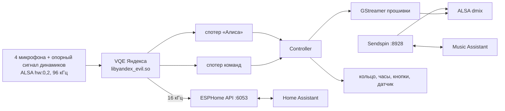

# cucumber-satellite

Яндекс Станция Миди (кодовое имя `cucumber`) и Яндекс Станция Лайт 2 (`plum`) как локальный
голосовой спутник и умная колонка для [Home Assistant](https://www.home-assistant.io/) — без облака
Яндекса.

> Поддержка Лайт 2 экспериментальная: программа на ней запускается, слушает и подключается к
> Music Assistant, но полный голосовой сценарий с Home Assistant и воспроизведение ещё не проверены.

Вместо штатного стека Яндекса (`maind`) на колонке работает небольшой нативный демон. Он говорит с
Home Assistant по протоколу ESPHome Native API и выглядит в HA как обычное ESPHome-устройство.
Для [Music Assistant](https://music-assistant.io/) он дополнительно является нативным
[Sendspin](https://www.sendspin-audio.com/)-плеером.

Железо колонки используется полностью и штатными средствами прошивки:

- **«Алиса» / «Яндекс»** — родная модель активационной фразы Яндекса и родное
  шумоподавление/эхоподавление (VQE) по микрофонам колонки (Миди — 4, Лайт 2 — 2) с вычитанием
  звука собственных динамиков.
- **Локальные голосовые команды** — «стоп», «громче», «тише» и т. д. выполняются на самой колонке,
  без HA (родная модель команд Яндекса).
- **Динамики** — воспроизведение HTTP-потоков через GStreamer прошивки, громкость через ALSA.
- **Кольцо светодиодов (Миди — 24 и логотип, Лайт 2 — 3), часы, кнопки, переключатель микрофона,
  датчик освещённости.**

Ни одна проприетарная библиотека Яндекса в репозитории не распространяется: демон загружает их с
самой колонки во время работы.

> Проект не связан с Яндексом. Всё, что вы делаете с устройством, — на ваш страх и риск.

## Что появляется в Home Assistant

| Сущность | Что делает |
|---|---|
| Assist satellite | Голосовой ассистент: активационные фразы «Алиса» / «Яндекс», таймеры, объявления (`assist_satellite.announce`), продолжение диалога |
| Media player | Воспроизведение медиа и TTS, громкость, mute; виден в Music Assistant через провайдер «Home Assistant» |
| Switch «Mute microphones» | Программное отключение микрофонов |
| Switch «Clock display» | Часы на передней панели |
| Number «Clock brightness» | Яркость часов (дополнительно подстраивается по датчику освещённости) |
| Light «Ring» | Кольцо как обычная лампа: цвет, яркость, эффекты Rainbow / Breathe |
| Binary sensor «Hardware mic mute» | Аппаратный переключатель микрофонов на корпусе |
| Sensor «Illuminance» | Датчик освещённости, лк |
| Event «Button» | `action`, `action_long`, `volume_up`, `volume_down` — для автоматизаций |

Часовой пояс для часов берётся из Home Assistant.

### Кнопки и индикация

- **Кнопка действия:** короткое нажатие — начать диалог без активационной фразы; во время ответа —
  прервать его; при звонке таймера — выключить. Долгое нажатие только отправляет событие в HA.
- **Громкость +/−:** шаг 5 %, уровень показывается на кольце.
- **Кольцо:** слушает → думает → отвечает, звонок таймера, отключённые микрофоны.
  Красная вспышка после «Алиса» значит, что HA не подключён к колонке.

### Локальные голосовые команды

Распознаются без Home Assistant, пока что-то играет (музыка, ответ ассистента, объявление,
звонок таймера) или в течение 2,5 с после «Алиса»: «Алиса, громче». В тишине и без активационной
фразы модель команд выключена, чтобы разговор в комнате не давал ложных срабатываний.

| Фраза | Действие |
|---|---|
| стоп / хватит | выключить звонок таймера, иначе прервать ответ, иначе пауза музыки |
| пауза | пауза |
| продолжи / играй | продолжить воспроизведение |
| громче / тише | громкость ±10 % |
| дальше / следующий, назад | следующий / предыдущий трек (Sendspin) |

## Требования

**Колонка:**

- Яндекс Станция Миди или Лайт 2 с root-доступом по adb: `adb shell` от root, по сети или USB.
- Прошивка, которая при загрузке запускает `/data/quasar/rootkeeper.sh`, то есть строка
  `[ -x /data/quasar/rootkeeper.sh ] && /data/quasar/rootkeeper.sh &` в
  `/system/vendor/quasar/onboot.sh`. Так устроены распространённые способы рута Станций. Сам рут в
  этот проект не входит.
- Проверено на прошивках `0.351.1.6.4197281754.20260528.142` (Миди) и
  `0.369.1.46.4778258659.20261013.133` (Лайт 2).

**Компьютер для сборки (Linux):**

- [zig 0.14.1](https://ziglang.org/download/) — кросс-компилятор (Миди: aarch64/glibc 2.36,
  Лайт 2: 32-битный armhf/glibc 2.30). zig 0.13 не подходит: собранные им 32-битные программы
  падают при запуске. Другой zig можно указать как `ZIG=/путь/к/zig`;
- `make`, `git`, `curl`, `cmake` ≥ 3.16, `ninja`, `patch`
  (cmake и ninja можно поставить через `uv tool install cmake ninja`);
- `adb` из Android platform-tools.

**Home Assistant** 2025.x или новее с интеграцией ESPHome и настроенным конвейером Assist
(STT/TTS с поддержкой русского).

## Сборка

```sh
make -C satellite -j"$(nproc)"                       # zig 0.14.1 в PATH
make -C satellite -j"$(nproc)" ZIG=~/opt/zig/zig     # или явно
```

При первой сборке скачиваются и собираются зависимости (sendspin-cpp и его библиотеки,
заголовки alsa-lib), все версии зафиксированы. Собираются обе версии: `satellite/build/aarch64/`
(Миди) и `satellite/build/armhf/` (Лайт 2); установщик сам выбирает нужную.

## Установка

```sh
satellite/deploy/install.sh                 # найти колонки в сети и выбрать, куда ставить
satellite/deploy/install.sh 192.168.1.50    # или сразу по адресу
satellite/deploy/install.sh --list          # только показать найденное
ZIG=~/opt/zig/zig satellite/deploy/install.sh   # если zig 0.14.1 не первый в PATH
```

Без адреса скрипт находит Станции через mDNS (`avahi-browse`). Штатные Станции объявляют себя
как `_yandexio._tcp`, а уже переведённые — как ESPHome-устройства `yandex-*`. Затем скрипт
подключается к ним по adb, определяет модель и показывает список. Поддерживаемые колонки с
root-доступом пронумерованы. Остальные (другие модели, adb без root) перечислены с причиной
пропуска.

Если `avahi-browse` нет или колонка не находится, `--scan` ищет открытый adb (порт 5555) по всей
подсети /24. Тогда другие Android-устройства в сети могут показать запрос «Разрешить отладку?» —
его можно отклонить.

Если программа не собрана, скрипт сначала собирает её. Затем на каждую выбранную колонку он:

1. копирует демон и служебные скрипты в `/data/cucumber-satellite`;
   предыдущий бинарник сохраняется как `.prev`;
2. добавляет строку автозапуска в `/data/quasar/rootkeeper.sh`, сохранив резервную копию
   `rootkeeper.sh.bak-<время>`;
3. останавливает стек Яндекса и запускает демон.

Изменяется только `/data`: системный раздел не трогается. Повторный запуск обновляет
установленную версию. `--yes` ставит на все найденные колонки без вопросов, `--no-enable` только
копирует файлы.

Дальше в Home Assistant: **Настройки → Устройства и службы**. Колонка обнаружится сама как
ESPHome-устройство `yandex-midi-xxxxxx` или `yandex-lite2-xxxxxx`. Если не обнаружилась, добавьте
интеграцию ESPHome вручную с IP колонки и портом `6053`, без ключа шифрования. В настройках
устройства выберите конвейер Assist и активационную фразу.

### Music Assistant

Music Assistant с поддержкой Sendspin находит колонку сам: плеер «Яндекс Станция Миди» или
«Яндекс Станция Лайт 2» с типом
**Sendspin**. Музыка идёт без потерь (FLAC), громкость и голосовые команды колонки управляют плеером
MA. Синхронное воспроизведение в группах с другими Sendspin-плеерами заложено протоколом, но пока
не проверялось.

По умолчанию колонка принимает Sendspin-подключения без сопряжения. Чтобы требовать сопряжение:

```sh
adb shell 'echo 0 > /data/cucumber-satellite/sendspin/unpaired_access'
adb shell /data/cucumber-satellite/ctl.sh restart
```

После этого при запросе сопряжения на часах появляется «----»: нажмите кнопку действия, и колонка
покажет код сопряжения.

### SSH (необязательно)

```sh
satellite/deploy/install.sh --ssh            # дополнительно соберёт и поставит dropbear
```

Устанавливает dropbear в `/data/dropbear` на порт 22. **Вход под root с пустым паролем** (`-B`).
Ставьте только в доверенной сети или поменяйте флаги в `ssh/start.sh`.

## Управление

На колонке (`adb shell` или ssh):

```sh
/data/cucumber-satellite/ctl.sh status    # кто сейчас работает: демон или стек Яндекса
/data/cucumber-satellite/ctl.sh log 100   # журнал (/tmp/cucumber-satellite.log)
/data/cucumber-satellite/ctl.sh restart
/data/cucumber-satellite/ctl.sh disable   # вернуть стек Яндекса, в том числе после перезагрузки
/data/cucumber-satellite/ctl.sh enable
```

Откат на предыдущую версию демона:

```sh
cd /data/cucumber-satellite && mv cucumber-satellite.prev cucumber-satellite && ./ctl.sh restart
```

Полное удаление: `ctl.sh disable`, затем удалить `/data/cucumber-satellite` и строку
`/data/cucumber-satellite/boot.sh` из `/data/quasar/rootkeeper.sh`.

Настройки (громкость, свет, часы, активационная фраза, часовой пояс) хранятся в
`/data/cucumber-satellite/state.conf`.

## Ограничения

- ESPHome API работает без шифрования: ключ (Noise) не поддерживается. Порт `6053` должен быть
  доступен только из вашей сети.
- Колонка по-прежнему использует DNS (`unbound`) и NTP прошивки, которые настроены на серверы
  Яндекса, и остаётся привязанной к аккаунту Яндекса.
- Zigbee-шлюз Станции не поддерживается.
- Голос ответов — тот, что выбран в TTS Home Assistant; голоса Алисы нет.

## Как это устроено



```
satellite/
  src/core/       event loop, логирование
  src/esphome/    ESPHome Native API (protobuf вручную), mDNS
  src/audio/      захват, VQE и спотеры Яндекса (через dlopen)
  src/media/      плеер на GStreamer прошивки, громкость
  src/sendspin/   Sendspin-плеер (sendspin-cpp)
  src/hw/         кольцо/логотип (framebuffer), часы, кнопки, датчик освещённости
  src/model.*     описание железа каждой модели, определение модели по devicetree
  src/controller.*  логика спутника и сущностей HA
  deploy/         install.sh (на компьютере), boot.sh / supervise.sh / ctl.sh (на колонке)
  tools/          диагностические утилиты (зонд железа, офлайн-тест спотера, тест API)
  third_party/    закреплённые версии зависимостей и тулчейн zig для CMake
ssh/              сборка и запуск dropbear
```

## Лицензия

[MIT](LICENSE). Сторонние библиотеки, которые скачиваются при сборке, распространяются под своими
лицензиями: sendspin-cpp, ArduinoJson, noise-c, IXWebSocket, micro-flac, micro-opus, alsa-lib,
dropbear, OpenSSH.
