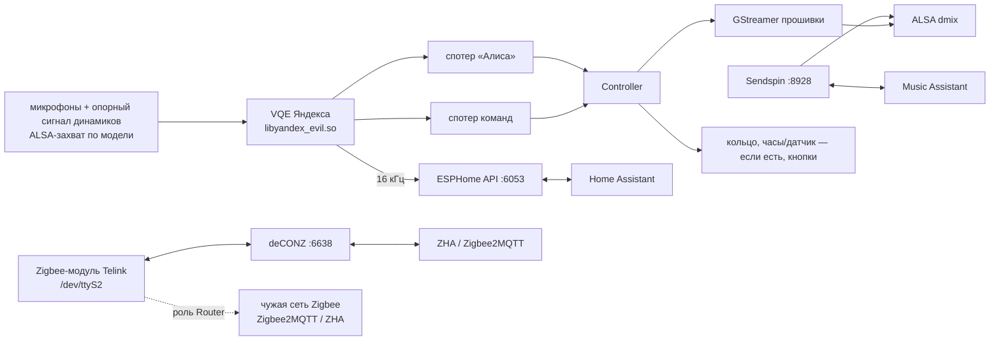

# Архитектура демона

Здесь — устройство кода в `satellite/`, которое из одного файла не видно: workspace, нормативная
модель исполнения для всех крейтов, плавающая точка, линковка sendspin-cpp, формат `state.conf`
для отката на `.prev`, порты. Здесь нет поведения отдельных сервисов и железа: поведение кода — в
коде, обоснования — в комментариях у кода; модели и библиотеки прошивки — [hardware.md](hardware.md),
голос и арбитраж — [voice.md](voice.md), Zigbee — [zigbee.md](zigbee.md), сборка, установка и
релизы — [development.md](development.md).

## Workspace

`satellite/` — Cargo workspace: `Cargo.toml`, `Cargo.lock` (коммитится; сборка, clippy и тесты
идут с `--locked`), `rust-toolchain.toml`, `Makefile` (кросс-сборки через cargo-zigbuild,
`make check`).

| Крейт | Ответственность |
|---|---|
| `pulsar` | демон: рантайм и завершение (`main.rs`), контроллер — вся логика сателлита, `state.conf`, отчёт о падении |
| `pulsar-core` | общие части: логгер, таймеры и реестр акторов, `Model` (описание железа модели), громкость, мелкие общие типы |
| `pulsar-alsa` | libasound прошивки, загружаемая через dlopen; обёртки PCM / ctl |
| `pulsar-esphome` | сервер ESPHome Native API (plaintext / Noise) |
| `pulsar-lan` | mDNS-респондер и арбитр wake word между станциями |
| `pulsar-audio` | микрофонный фронтенд (захват → VQE Яндекса → спотеры → поток 16 кГц) и музыкальные признаки опорного сигнала динамика |
| `pulsar-media` | воспроизведение через GStreamer прошивки (каналы Music / Announce) и `Mixer` |
| `pulsar-sendspin` | Sendspin-плеер на sendspin-cpp через C-шим `shim/` (см. [«Линковка C++ (sendspin-cpp)»](#линковка-c-sendspin-cpp)) |
| `pulsar-hw` | кольцо LED / логотип и кнопки |
| `pulsar-clock` | часы, их стоковые анимации, шрифт, датчик освещённости |
| `pulsar-zigbee` | радио Zigbee Миди: роли и прошивка радио; внутренний API — в `//!` `src/lib.rs` |
| `pulsar-update` | бэкенд сущности обновления «Firmware» в HA |

`third_party/` — только сборка sendspin-cpp.

Утилиты — `crates/<крейт>/src/bin/<имя>.rs`; аргументы — в `//!` каждой утилиты.

| Утилита | Назначение |
|---|---|
| `alsa_abi_probe` | ABI hw-params alsa-lib на PCM `null`, без звука |
| `api_selftest` | API-сервер с печатающими обработчиками для внешнего клиента |
| `lan_probe` | проверки mDNS и арбитража на альтернативных портах рядом с демоном |
| `ww_offline` | офлайн-прогон стокового спотера по записи захвата |
| `frontend_probe` | микрофонный фронтенд без демона: события, частоты, запись сырого захвата |
| `player_probe` | сценарии плеера и `Mixer` на ограниченной громкости |
| `sendspin_probe` | Sendspin-плеер без демона, для `tools/sendspin_server.py` |
| `hw_probe` | LED, часы, кнопки, датчик освещённости |
| `update_probe` | HTTPS-клиент и апдейтер без демона |
| `zigbee_probe` | радио Миди без демона: координатор с сервером deCONZ, идентификация и запись прошивки |

### Потоки данных

Схема демона; число микрофонов, PCM захвата и его частота зависят от модели
([hardware.md, «Модели»](hardware.md#модели)).

## Модель исполнения

Нормативно для всех крейтов; код ссылается на номера пунктов.

1. В процессе один рантайм tokio `current_thread` и `LocalSet`. Все задачи порождаются через
   `pulsar_core::actors::spawn_actor`; `tokio::spawn` не используется.
2. Каждый сервис устроен одинаково:
   - `pub fn spawn(cfg…) -> (XHandle, UnboundedReceiver<XEvent>)`; сервис без событий возвращает
     только handle.
   - Синхронное открытие ресурсов (bind, open, dlopen) — внутри `spawn`. При ошибке: если
     контроллер продолжает пользоваться объектом, `spawn` логирует ошибку и возвращает
     деградированный handle (команды принимаются, вывода нет); если контроллер без него
     обходится — `spawn` возвращает `Result<_, String>`.
   - `XHandle`: `Clone`, все методы принимают `&self`, не `async` и никогда не блокируют. Команды
     уходят в `tokio::sync::mpsc::UnboundedSender<Cmd>` и обрабатываются актором в порядке FIFO.
     Геттеры читают разделяемое состояние, которое актор (или рабочий поток) обновляет до отправки
     соответствующего события.
   - Все handle живут в `LocalSet` контроллера и могут быть `!Send`. Поля, которые пишут только на
     потоке рантайма (handle и актор), — `Rc<Cell>` / `Rc<RefCell>`; borrow не держится через
     `.await` и не уходит в FFI-колбэки. Поля, которые пишет `std::thread`, — `Arc` + атомики;
     `Relaxed` достаточно, порядок относительно события задаёт канал.
   - Поле, которое пишет handle, существует в одном экземпляре, в общей ячейке: актор читает и
     меняет его на месте, не держит копию и не публикует как снимок.
   - Сразу после команды геттер, как правило, отдаёт прежнее значение: состояние меняет актор или
     рабочий поток. Если геттер синхронный (значение задаёт сам handle-метод или `spawn`), это
     сказано в его `///`.
   - События идут через `tokio::sync::mpsc::UnboundedReceiver<XEvent>`. Контроллер сам владеет
     своим состоянием и выбирает события через `tokio::select!`; реентрантных вызовов нет.
   - Ответ на запрос, который можно отменить или вытеснить (воспроизведение, арбитраж, голосовой
     run), несёт id, возвращённый методом handle (например, `PlayId`); устаревшие id контроллер
     игнорирует. У проверки и установки обновлений id только связывает ответ с запросом.
3. Таймеры внутри актора — `pulsar_core::Timers<K>` (ключ — enum актора); порядок срабатывания
   описан в `//!` `pulsar-core/src/timers.rs`. Ключи одного снимка срабатывают подряд, без других
   событий между ними, только если `timers.next()` — первая ветка `tokio::select!` с `biased;`.
4. Блокирующие и реалтайм-циклы — отдельные именованные `std::thread` (захват и VQE, главный цикл
   GLib, писатель ANNOUNCE и его чтение url, запись прошивки радио; по тем же правилам — колбэк
   sink на потоке sendspin-cpp). Наружу они отправляют данные через `UnboundedSender`, команды
   получают через атомики, `Mutex` или `std::sync::mpsc`.
5. Актор завершается, когда закрыт его канал команд (все handle уничтожены), и при выходе
   убирает за собой. Потоки останавливаются в `Drop` своего владельца (флаг + join); исключения
   описаны у кода.
6. Не держать `RefCell`-borrow через `.await`. Состояние актора хранится по значению в его задаче.
7. Логи пишутся через `log::{debug,info,warn,error}!`, бэкенд — в `pulsar-core`. Утилита, чей
   крейт-бинарь назван не `pulsar*`, вызывает `pulsar_core::add_own_target(module_path!())` (рядом
   с `init_logger()`, порядок не важен), иначе её записи считаются чужими.
8. `unsafe` и все вызовы `libc` (включая `std::env::set_var`) живут только в модулях
   `sys.rs` / `ffi.rs` (в `pulsar-media` таким же FFI-модулем служит `gst.rs`),
   `pulsar-core/src/compat.rs` и в обработчике крашей.
   - В каждом крейте `#![deny(unsafe_op_in_unsafe_fn)]`, у каждого блока `unsafe` — комментарий
     `// SAFETY:`.
   - Символы dlopen резолвятся один раз в структуру указателей на функции.
   - Раскладки C-структур — `#[repr(C)]` с compile-time `assert!(core::mem::offset_of!(…) == …)`
     под `#[cfg(target_arch)]`.
9. Комментарии в коде — [AGENTS.md, «Правила кода»](../AGENTS.md#правила-кода).
10. Должен проходить `make -C satellite check` (состав — target `check` в `satellite/Makefile`).

## Плавающая точка (FMA)

- Rust сам никогда не сливает умножение со сложением. Там, где важно побитовое совпадение со
  станционной сборкой (пороги, округление до целого, гистерезис, решение о бите), `a + b*c`
  записано как `mul_add` — одно округление вместо двух; результат может отличаться от раздельных
  операций на 1–2 ulp. У такого места — комментарий с причиной. Сливания не добавлять и не
  убирать.
- Расстановку `mul_add` фиксируют golden-тесты: `pulsar-audio` `tests/spectrum_golden.rs`,
  `pulsar-clock` `clock_fx.rs`, `pulsar-hw` `led_fx/tests.rs`, `pulsar-media`
  `tests/mixer_golden.rs`, `pulsar-core` `ambient.rs`. Без теста, но по тому же правилу: уровень
  wake (`frontend.rs`, `mean_square`), энергии `ww_offline`, матрица цвета корпуса (`leds.rs`),
  диапазоны музыки часов (`clock.rs`), число громкости на часах (`controller/media.rs`).
- armhf-сборка даёт аппаратный `vfma` для `mul_add` только с `-C target-cpu=cortex-a53` (его
  ставит Makefile, см. [«Линковка C++ (sendspin-cpp)»](#линковка-c-sendspin-cpp)). Без флага
  (например, ручной `cargo build --target armv7-unknown-linux-gnueabihf`) `mul_add` становится
  вызовом libm `fmaf` / `fma`: результат тот же, но в горячих циклах на каждый сэмпл заметно
  медленнее. На x86_64-хосте `mul_add` — тоже вызов libm.
- `sinf` / `cosf` / `log10f` armhf-сборка берёт из compiler_rt zig, aarch64 — из glibc; они иногда
  расходятся на 1 ulp, поэтому спектр сравнивается с допуском.

## Линковка C++ (sendspin-cpp)

Шим `pulsar-sendspin/shim/` и статические библиотеки sendspin-cpp — единственный C++ в сборке —
линкуются через `cargo zigbuild` в окружении Makefile (`CARGO_ENV` в
[`satellite/Makefile`](../satellite/Makefile); `-C target-cpu=cortex-a53` для armhf). Рецепт
минимальный: [`build.rs`](../satellite/crates/pulsar-sendspin/build.rs) компилирует шим через `cc`
и линкует только `c++`.

- `c++abi` и `-Wl,--start-group` / `--end-group` не нужны: zig сам линкует свои libc++,
  libc++abi и libunwind статически. Для статических библиотек с перекрёстными ссылками
  `--start-group` остаётся запасным путём; сейчас порядок держит список библиотек в `build.rs`.
- `NEEDED`: aarch64 — только `libm.so.6` и `libc.so.6` (максимум версий символов `GLIBC_2.34`);
  armhf — `libm.so.6`, `libpthread.so.0`, `libc.so.6`, `libdl.so.2`, `ld-linux-armhf.so.3`
  (фактический максимум `GLIBC_2.18`), `hard-float ABI`.
- `cc` печатает безвредные предупреждения проверки компилятора через обёртки cargo-zigbuild:
  aarch64 — `zig: error: version '.2.36' in target triple 'aarch64-unknown-linux-gnu.2.36' is invalid`,
  armhf — `…/cargo-zigbuild/0.24.0/aeabi_unaligned.c:1:1: error: FileNotFound`. Объект при этом
  собирается и линкуется.

## state.conf и откат на .prev

`state.conf` — `key=value` по строке. `supervise.sh` может откатить станцию на `.prev` (более
старую сборку, в том числе C++-демон), и оба бинаря читают один файл, поэтому формат побайтно
совместим с C++-демоном:

- Существующие ключи формат не меняют: числа пишутся как `%g` (6 значащих цифр) и читаются как
  `strtof`, в C-локали независимо от `setlocale` где-либо в процессе; булевы — `0` / `1`;
  `zigbee_flash_failed` — hex в нижнем регистре без `0x`.
- Новые ключи добавляются с безопасными значениями по умолчанию.
- Громкость: `volume2=` — громкость на стоковой кривой, основное значение; `volume=` — тот же
  raw-уровень на кривой прежних сборок, для бинаря `.prev`. На моделях с программной громкостью
  (Мини) `volume=` хранит саму нормализованную громкость 0..1, а не raw-уровень.
- Обычная запись отложена (`persist()`, см. `//!` `pulsar/src/settings.rs`). Новый ключ, который
  должен пережить рестарт, падение или замену бинаря сразу после изменения, пишется через
  `persist_now()`.

Смысл отдельных ключей: `zigbee_role` / `zigbee_flash_failed` —
[zigbee.md, «Роли и state.conf»](zigbee.md#роли-и-stateconf); `update_attempt` —
[development.md, «Обновления из HA»](development.md#обновления-из-ha).

## Порты и тестовый режим

- Базовые порты: ESPHome API 6053, Sendspin 8928, deCONZ 6638, арбитраж wake word 6054 (UDP
  broadcast; протокол — [voice.md, «Арбитраж между станциями»](voice.md#арбитраж-между-станциями)).
- `PULSAR_PORT_OFFSET=<u16>` (по умолчанию 0) прибавляется ко всем четырём портам. Тестовый
  экземпляр (`tools/station.sh test-start`; только при остановленном супервизоре, см.
  [stations.md](stations.md)) работает на смещённых портах: HA, Music Assistant и Z2M/ZHA к нему
  не подключаются, а в арбитраже живых станций на 6054 он не участвует.
- При ненулевом offset mDNS не запускается: HA и Music Assistant тестовый экземпляр не видят.
- Порты задаёт контроллер и передаёт сервисам в конфиге; умолчания конфигов
  (`ApiConfig::default`) демон не использует.
