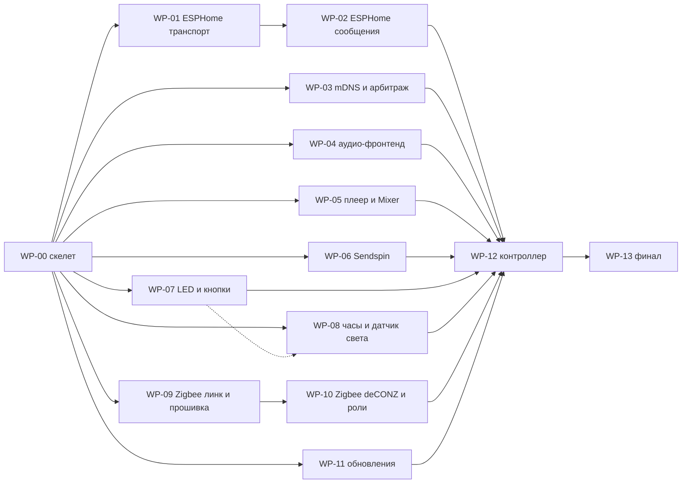

# PROGRESS — порт pulsar на Rust

**Цель.** Переписать демон pulsar (`satellite/src`) и утилиты (`satellite/tools`) с C++20 на Rust с тем же внешним поведением. Работа идёт в интеграционной ветке `rust`; пакеты вливаются прямым fast-forward push в `origin/rust`, по одному коммиту на пакет. C++-эталон — тег `rust-port-base`.

Ссылки: [PROCESS.md](PROCESS.md) — регламент агента; [ARCHITECTURE.md](ARCHITECTURE.md) — архитектура и контракты; [STATIONS.md](STATIONS.md) — протокол станций; спеки — [wp/](wp/); отчёты ревью — [reviews/](reviews/README.md).

## Легенда статусов

- `свободен` — пакет можно брать, если все пакеты из «Старт после» влиты;
- `в работе` — захвачен исполнителем (указан в колонке «Исполнитель»);
- `ревью` — работа готова, идёт ревью;
- `влит` — в `origin/rust`;
- `заблокирован: <причина>` — работа остановлена, причина обязательна.

Колонки Midi и Lite 2: `требуется` — проверка на станции ещё не выполнена; `—` — не нужна; после проверки `да` или `нет: …`.

## Пакеты

| ID | Пакет | C++ строк | Старт после | Влить после | Статус | Исполнитель | Ревью | Midi | Lite 2 | Заметки |
|---|---|---|---|---|---|---|---|---|---|---|
| WP-00 | Скелет: workspace, сборка, CI, core, alsa, main, документы | ~1000 + инфра | — | — | влит | Morvex885 (агент) | [reviews/WP-00.md](reviews/WP-00.md) | да | да (через adb: на станции нет ssh) |  |
| WP-01 | ESPHome: транспорт, Noise, клиенты, voice-владелец | ~1490 | WP-00 | — | влит | Morvex885 (агент WP-01) | [reviews/WP-01.md](reviews/WP-01.md) | — | — |  |
| WP-02 | ESPHome: сообщения, сущности, команды, api_selftest | ~1190 | WP-01 | — | свободен |  | [reviews/WP-02.md](reviews/WP-02.md) | требуется | требуется |  |
| WP-03 | mDNS + арбитраж wake word, lan_probe | ~850 | WP-00 | — | в работе | Morvex885 (агент WP-03) | [reviews/WP-03.md](reviews/WP-03.md) | требуется | требуется |  |
| WP-04 | Аудио-фронтенд: VQE/спотер, захват, спектр, ww_offline | ~890 | WP-00 | — | в работе | Morvex885 (агент WP-04) | [reviews/WP-04.md](reviews/WP-04.md) | требуется | требуется |  |
| WP-05 | Плеер (GStreamer) + Mixer, player_probe | ~1010 | WP-00 | — | в работе | Morvex885 (агент WP-05) | [reviews/WP-05.md](reviews/WP-05.md) | требуется | требуется |  |
| WP-06 | Sendspin: C-шим над sendspin-cpp, сервис, ALSA-sink | ~840 + шим | WP-00 | — | в работе | Morvex885 (агент WP-06) | [reviews/WP-06.md](reviews/WP-06.md) | требуется | требуется |  |
| WP-07 | LED (led_fx, композитор, вывод) + кнопки, hw_probe (LED/ввод) | ~1500 | WP-00 | — | влит | Morvex885 (агент WP-07) | [reviews/WP-07.md](reviews/WP-07.md) | да | да |  |
| WP-08 | Часы + clock_fx + датчик света, hw_probe целиком | ~1380 | WP-00 | WP-07 | в работе | Morvex885 (агент WP-08) | [reviews/WP-08.md](reviews/WP-08.md) | требуется | требуется |  |
| WP-09 | Zigbee: линк, координатор, роутер, прошивальщик | ~1440 | WP-00 | — | в работе | Morvex885 (агент WP-09) | [reviews/WP-09.md](reviews/WP-09.md) | требуется | — |  |
| WP-10 | Zigbee: deCONZ-сервер, сервис ролей, zigbee_probe | ~1180 | WP-09 | — | свободен |  | [reviews/WP-10.md](reviews/WP-10.md) | требуется | — |  |
| WP-11 | Обновления: HTTPS (rustls), updater, update_probe | ~880 | WP-00 | — | влит | Morvex885 (агент WP-11) | [reviews/WP-11.md](reviews/WP-11.md) | да | да |  |
| WP-12 | Контроллер целиком + тестовый режим портов | ~1650 | WP-02, WP-03, WP-04, WP-05, WP-06, WP-07, WP-08, WP-10, WP-11 | — | свободен |  | [reviews/WP-12.md](reviews/WP-12.md) | требуется | требуется |  |
| WP-13 | Финал: паритет, замеры, AGENTS.md/README, чек-лист владельца | — | WP-12 | — | свободен |  | [reviews/WP-13.md](reviews/WP-13.md) | требуется | требуется |  |

## Граф зависимостей

Сплошная стрелка — «старт после», пунктир — «влить после».



## Чек-лист владельца

Пункты, которые агент не может проверить сам. Отмечает владелец.

- [ ] «Алиса» и «Яндекс» голосом на обеих станциях → конвейер HA → ответ TTS.
- [ ] Локальные команды голосом во время музыки: стоп, пауза, громче, тише, дальше.
- [ ] Арбитраж: обе станции слышат wake word, отвечает ближняя.
- [ ] Реальный HA: сущности те же (без новых устройств и дублей), управление работает, Noise-ключ сохранился.
- [ ] HA media player: TTS, анонсы, музыка по URL — качество звука на слух.
- [ ] Music Assistant по Sendspin: обнаружение, сопряжение (код на часах), воспроизведение, пауза/следующий, визуализация на кольце и часах.
- [ ] Голосовые таймеры HA: отсчёт на часах, звонок, остановка кнопкой и wake word.
- [ ] LED и часы визуально: голосовые состояния, эффекты, музыкальные стили, цвет корпуса, лица и текст часов.
- [ ] Сенсорные кнопки и аппаратный mute.
- [ ] Zigbee на Midi: coordinator с Z2M/ZHA, join/leave роутера.
- [ ] После вливания в `main` и релиза: обновление C++-станции на Rust-релиз из HA и откат.

## Как посчитать остаток

Оставшийся C++ (строки в `satellite/src` и `satellite/tools/*.cpp`):

```sh
git ls-files 'satellite/src/*' 'satellite/tools/*.cpp' | xargs wc -l
```

## Заметки

- WP-00: `rust-port-base` = `5059a8d` (до тега `origin/main` ушёл вперёд на коммит смены лицензии на AGPL-3.0; `satellite/` в нём не менялся). `VERSION` в Makefile — `git describe --tags --match 'v*' --always --dirty`: иначе ближайшим тегом был бы `rust-port-base`, и updater не разобрал бы версию.
- Lite 2: ssh включён владельцем (dropbear, как на Midi); station.sh работает на обеих станциях. WP-00 на Lite 2 проверялся через adb до включения ssh.
- WP-07: armhf собирается с `-C target-cpu=cortex-a53` (`RUSTFLAGS` в Makefile), как C++ `-mcpu=cortex_a53`: `mul_add` — аппаратный `vfma`, FMA-паритет с C++ (ARCHITECTURE.md, рецепт линковки). sysfs `brightness` кольца Lite 2 ограничен 63 (reviews/WP-07.md).
- WP-11: кросс-clippy в `make check` идёт через `cargo-zigbuild clippy` (build-скрипт `ring` компилирует C для цели; ARCHITECTURE п.10). `make check` теперь требует zig (любой версии) и cargo-zigbuild 0.24.0; job `check` в CI ставит zig 0.14.1 и cargo-zigbuild.
- WP-11: раздел AGENTS.md «Updates from HA» (и строка Layout `satellite/src/update/`) ещё описывает HTTPS на OpenSSL прошивки через dlopen; WP-13 должен переписать его под `pulsar-update` (rustls + ring, CA-бандл `/etc/ssl/certs/ca-certificates.crt`).
- WP-11: при закрытии всех handle updater отменяет идущую установку до `--version` и замены (бинарь не меняется, `Installed` не приходит); C++ доводил её до конца. Поэтому WP-12 при выходе с установкой в полёте стирает `update_attempt` (иначе автообновление пропускало бы тег) — пункт добавлен в `wp/WP-12.md`.
- WP-01: контракт `[workspace.dependencies]` — `snow` без фич по умолчанию (`use-chacha20poly1305`, `use-sha2`, `use-curve25519`, `use-getrandom`): только примитивы NNpsk0, без `ring`, AES-GCM и BLAKE2, которые тянет фича `std` snow 0.10.0.
